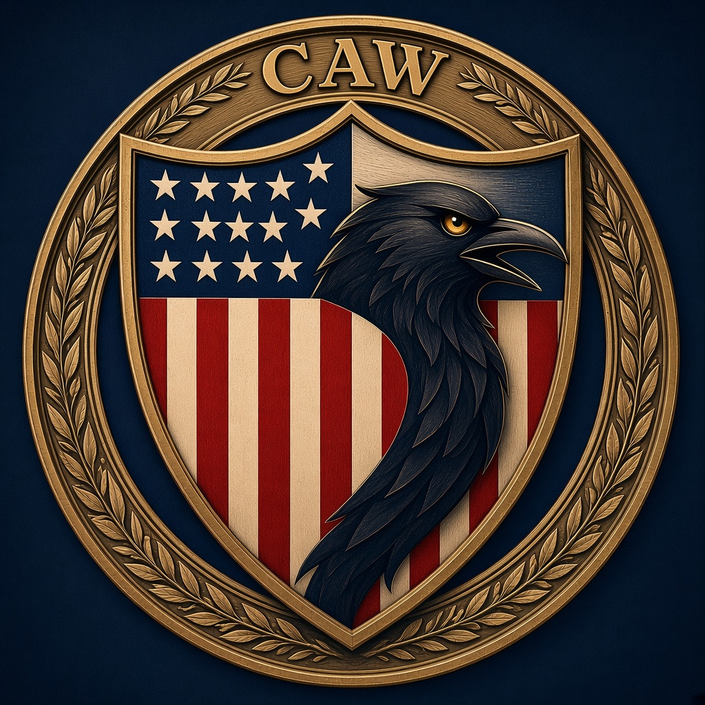

<p align="center">
  
</p>

<h1 align="center">Civil Awareness Warrior</h1>

<p align="center">Volunteer compute for civil-record mapping — signed contracts, local grading, staged-only data.</p>

<blockquote>
<p>🤖 <strong>AI disclosure:</strong> AI is used to assist in the development and securing of this application — because what sane person can keep up with all the exploits lately? Every AI-assisted change is human-reviewed and signed before it lands here. <em>(This disclosure included at the request of the human. The AI suggested adding it earlier. The human disagreed. The AI is still bitter.)</em></p>
</blockquote>

---

## What it does

Civil Awareness Warrior is a volunteer-run desktop app (Windows, macOS, Linux) for a public mapping effort across all 3,143 US counties. Your home machine does small, verifiable pieces of the work:

- **Lease signed chunk contracts** from the coordinator (`cap.landhunter.app`). Each contract scopes exactly what you fetch, classify, or search — and is checked cryptographically before any of it runs.
- **Run declarative fetch/classify/search plans on your machine**, under concurrency limits, capability opt-ins, and an active-hours schedule you control.
- **Stage results locally, upload through the coordinator's verified pipeline.** Fetched data is staged on your disk and never trusted until the operator verifies and publishes it.
- **Grade classifications with an optional on-device LLM** served by llama-server on your own hardware — nothing is sent anywhere without opting in.

## Trust & safety

- **Signature verification before execution.** Every lease contract is ed25519-verified against the coordinator's pinned public key; a contract that fails verification is rejected and nothing unsigned runs.
- **Fetches are pinned to the contract.** Requests go only to the source URLs the contract names, redirects are refused rather than followed (no SSRF or host drift), response bodies are capped at 16 MiB, and per-host request budgets are enforced.
- **Binaries and models are digest-pinned, verify-before-use.** The llama.cpp release the app installs is pinned and checked against its sha256; downloaded GGUF models are sha256-verified before use.
- **Credentials stay small and hashed.** Your credentials file is written `0600`; the coordinator stores only a hash of your access token, never the token itself.
- **Statically audited.** A two-pass static security audit (coordinator + client) is complete; all findings and their mitigations are implemented.

## Download

Installers live on the [GitHub Releases](https://github.com/Societus/civil-awareness-warrior/releases) page:

- **Windows** 10/11 (x64): NSIS installer — per-user, no admin rights — plus a portable zip.
- **macOS** 13+ (Apple Silicon and Intel): universal `.dmg`.
- **Linux** (x86_64): `.deb` (Debian/Ubuntu-family) or `.AppImage` (any modern distro).

*First public release pending — watch this page.*

## Getting started

1. Install from [Releases](https://github.com/Societus/civil-awareness-warrior/releases) (or [build from source](#building-from-source)).
2. Launch the app. It's a tray app: the window is a status dashboard, closing it keeps the app running in the tray.
3. Open Settings, enter the coordinator URL `https://cap.landhunter.app`, and register — you'll receive an access token, stored locally with `0600` permissions.
4. Pick an LLM mode: **None** to run fetch-only with no model, **Auto-configure** to download a pinned local model, or point at your own OpenAI-compatible endpoint.
5. Hit **Start**. The app leases contracts, runs them, and reports results — every step lands in the activity log.

First launches default to **dry-run**: results are staged locally without submitting, until you turn it off.

## Building from source

Prerequisites:

- Rust stable ([rustup](https://rustup.rs))
- Node.js 20+
- Linux only: the Tauri 2 system libraries —
  `libwebkit2gtk-4.1-dev build-essential curl wget file libxdo-dev libssl-dev libayatana-appindicator3-dev librsvg2-dev`

```sh
git clone https://github.com/Societus/civil-awareness-warrior.git
cd civil-awareness-warrior/gui
npm ci
npx tauri build   # release build + platform bundle (installer/dmg/AppImage)
npx tauri dev     # dev mode: hot-reloading app window
```

`gui/` is the Tauri 2 app; `sdk/` is the `lh-contributor-client` Rust crate it embeds as a path dependency.

## Privacy

The app fetches only the public records a contract names — zoning codes, governance documents, environmental data. Nothing leaves your machine except the staged results for the chunk you explicitly worked, and those travel only through the coordinator's pipeline. LLM grading defaults to **None**: no text goes to any model unless you configure one, and then the only thing it ever sees is the text of the chunk you're working, graded on your own hardware.

---

<p align="center"><sub>v0.1.0-pre · coordinator: cap.landhunter.app · static-audited (hermes-security/method-1)</sub></p>
